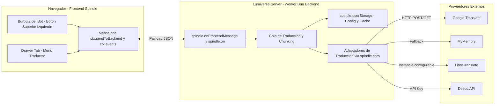

# Lumiverse Translator — Documento de Diseño y Arquitectura

## 1. Resumen del Proyecto

**Lumiverse Translator** es una extensión pensada para **Lumiverse** ([lumiverse.chat](https://lumiverse.chat/)) que permite traducir cómodamente los mensajes generados por el bot o personaje durante una conversación o sesión de roleplay.

Sus objetivos principales son:

1. **Botón directo por mensaje:** Mostrar un botón compacto de traducción en la **esquina superior izquierda** de cada mensaje del bot/personaje para traducirlo al idioma configurado o alternar al texto original con un clic.
2. **Menú de configuración de la extensión:** Ofrecer un panel integrado dentro de Lumiverse para seleccionar el **idioma de destino**, el **idioma de origen**, el **motor de traducción** (Google Translate por defecto, además de proveedores alternativos) y elegir entre traducción **manual** (solo al pulsar el botón) o **automática** (traducir todos los mensajes nuevos que envíe el bot).
3. **Traducción no destructiva:** Mantener intacto el historial original en la base de datos de Lumiverse para no alterar el contexto ni la calidad de las respuestas enviadas al LLM.

---

## 2. Enfoque de Plataforma: Extensión Nativa de Lumiverse (Spindle) vs. Extensión de Navegador

Lumiverse es una plataforma *self-hosted* de chat con personajes construida en TypeScript y Bun que cuenta con su propio sistema oficial de extensiones llamado **Spindle**. Por ese motivo, la arquitectura principal propuesta es una **extensión nativa Spindle**:

* **Funciona en cualquier despliegue de Lumiverse:** Ya sea en `localhost`, red local (LAN), Hugging Face Spaces o dispositivos móviles, sin tener que instalar extensiones externas en cada navegador.
* **Sin bloqueos CORS:** El backend de Spindle incluye `spindle.cors()` para realizar peticiones HTTP desde el servidor hacia servicios como Google Translate, MyMemory, LibreTranslate o DeepL.
* **Tema visual nativo:** Los componentes montados mediante `ctx.components.*` heredan automáticamente el tema claro/oscuro, colores de acento y estética de Lumiverse.
* **Compatibilidad con la virtualización del chat:** Lumiverse desmonta mensajes fuera de la pantalla al hacer scroll; `ctx.dom.inject()` y las utilidades `ctx.dom.*` están diseñadas para preservar elementos inyectados durante esos ciclos.
* **Persistencia y acceso directo a mensajes:** Cuenta con almacenamiento aislado por usuario (`spindle.userStorage`) y eventos nativos del ciclo de generación (`GENERATION_ENDED`, `MESSAGE_SWIPED`, `CHAT_CHANGED`).

> [!NOTE]
> **Alternativa como extensión de navegador (Chrome / Edge Manifest V3):** Si en lugar de instalar la extensión dentro de Lumiverse prefieres una extensión tradicional de navegador (carpeta cargada en `chrome://extensions` con *popup* y *content script*), toda la lógica de traducción, caché y posicionamiento del botón descrita en este documento es reutilizable cambiando únicamente la capa de comunicación (`chrome.storage` / `background.js`) y la detección del DOM por `MutationObserver`.

---

## 3. Requisitos Funcionales y Experiencia de Usuario (UX)

### 3.1 Botón de traducción en mensajes del bot/personaje

* **Alcance:** Se muestra únicamente en las burbujas de mensajes generados por el bot/personaje (`role === 'assistant'`), excluyendo mensajes del usuario o avisos del sistema.
* **Ubicación:** En la **esquina superior izquierda** de la burbuja/tarjeta del mensaje del bot, alineado limpiamente para no tapar el avatar del personaje, el nombre ni la barra nativa de acciones del mensaje (con margen superior/izquierdo configurable mediante CSS si el tema o ancho de pantalla lo requiere).
* **Traducción no destructiva:** La traducción se aplica solo sobre la vista renderizada en el navegador. El contenido guardado en la base de datos de Lumiverse y el historial que recibe el modelo de IA permanecen sin modificar en su idioma original.
* **Modos de visualización configurables:**
  * **Reemplazo visual (por defecto):** Oculta visualmente el texto original en pantalla y muestra en su lugar la traducción conservando el formato (párrafos, cursivas de acción, diálogos y bloques de código).
  * **Modo bilingüe:** Mantiene visible el mensaje original y añade debajo la traducción dentro de un bloque secundario con un separador sutil.

#### Estados del botón

| Estado | Apariencia sugerida | Comportamiento al hacer clic |
| :--- | :--- | :--- |
| **Original (inactivo)** | Icono de traducción discreto + etiqueta corta opcional (ej. `Traducir`) | Solicita la traducción del mensaje al backend o la recupera de caché al instante. |
| **Traduciendo (spinner)** | Indicador de carga giratorio y botón deshabilitado temporalmente | Ignora clics repetidos mientras la petición sigue en curso. |
| **Traducido (activo)** | Icono resaltado con color de acento (ej. `Original` / badge del idioma destino) | Alterna de forma instantánea entre **Traducido** y **Original** usando la caché local sin volver a llamar a la API. |
| **Error** | Icono de advertencia + notificación `spindle.toast.error(...)` | Permite reintentar la traducción del mensaje inmediatamente. |

### 3.2 Menú de la Extensión (Drawer Tab en Lumiverse)

La extensión registrará una pestaña propia en el cajón lateral (*drawer*) de Lumiverse mediante:

```ts
ctx.ui.registerDrawerTab({ id: 'lumi-translator', title: 'Traductor' })
```

Al usar controles compatibles con el host (`ctx.components.*` y estilos alineados a variables del tema), el menú se integrará de forma natural con el modo claro/oscuro de la interfaz.

#### Controles incluidos en el menú

1. **Interruptor general:** Activar o desactivar la extensión globalmente sin desinstalarla.
2. **Idioma de destino:** Selector con los idiomas más frecuentes (`es` Español, `en` Inglés, `pt` Portugués, `fr` Francés, `de` Alemán, `it` Italiano, `ja` Japonés, `ko` Coreano, `zh-CN` Chino simplificado, `ru` Ruso, entre otros).
3. **Idioma de origen:** `auto` (detección automática por defecto) o un idioma específico.
4. **Modo de traducción:**
   * **Manual:** Solo traduce un mensaje cuando el usuario presiona el botón en la esquina superior izquierda.
   * **Automático:** Traduce automáticamente cada nuevo mensaje que genere el bot al finalizar la respuesta.
   * *Opciones adicionales de automatización:* Interruptores opcionales para auto-traducir también al navegar por regeneraciones (*swipes*) y para traducir automáticamente los mensajes visibles del bot al abrir o cambiar de chat.
5. **Proveedor de traducción:** Selector de motor (`Google Translate` por defecto, `MyMemory`, `LibreTranslate`, `DeepL`), con campos dinámicos según el proveedor elegido:
   * URL base de instancia (para **LibreTranslate**).
   * API Key (opcional en LibreTranslate; requerida en **DeepL**, con selector Free/Pro).
   * Opción de **respaldo automático (fallback)** a un motor secundario (por ejemplo, MyMemory) si el principal falla o limita peticiones.
6. **Modo de visualización:** Selector entre `Reemplazo visual` y `Modo bilingüe`.
7. **Acciones rápidas:**
   * **Traducir mensajes visibles:** Traduce en cola todos los mensajes del bot que estén actualmente en pantalla.
   * **Restaurar todos al original:** Vuelve a mostrar el texto original de todos los mensajes del chat activo sin borrar la caché.
   * **Limpiar caché de traducciones:** Elimina las traducciones guardadas en el almacenamiento del usuario.

---

## 4. Motores / Proveedores de Traducción ("Google Translate, etc.")

Todos los motores implementarán una interfaz unificada `TranslationProvider` en el backend para que el resto de la extensión sea independiente del servicio utilizado:

```ts
export interface TranslationRequest {
  text: string
  sourceLang: string // 'auto' o código ISO
  targetLang: string
}

export interface TranslationResponse {
  translatedText: string
  detectedSourceLang?: string
  providerId: ProviderId
}

export interface TranslationProvider {
  id: ProviderId
  label: string
  requiresApiKey: boolean
  translate(req: TranslationRequest, config: ProviderConfig): Promise<TranslationResponse>
}
```

### Comparativa de proveedores soportados

| Proveedor | Costo / Credenciales | Endpoint / Mecanismo (vía `spindle.cors()`) | Ventajas y rol en la extensión |
| :--- | :--- | :--- | :--- |
| **Google Translate** *(por defecto)* | Gratis, sin API Key | `POST https://translate.googleapis.com/translate_a/single?client=gtx&sl={sl}&tl={tl}&dt=t` con `Content-Type: application/x-www-form-urlencoded` | Rápido, buena calidad general y soporte amplio de idiomas. Usar `POST` en lugar de `GET` permite enviar mensajes largos sin chocar con límites de URL. |
| **MyMemory** *(respaldo / fallback)* | Gratis, sin API Key (límite diario anónimo; opcionalmente ampliable con email) | `GET https://api.mymemory.translated.net/get?q=...&langpair=en\|es` | Excelente proveedor secundario automático si Google Translate responde temporalmente con HTTP `429` o error de red. *(Nota: MyMemory no acepta `auto` como idioma de origen; si el origen está en `auto`, se resuelve primero o se usa un idioma base configurado.)* |
| **LibreTranslate** *(self-hosted)* | Gratis en instancia propia o pública (API Key opcional) | `POST {instanceUrl}/translate` (JSON `{ q, source, target, format: 'text', api_key }`) | Ideal para usuarios que ya auto-hospedan Lumiverse y prefieren 100 % privacidad sin enviar sus chats a servicios de terceros. |
| **DeepL API** *(opcional)* | Requiere API Key (plan Free o Pro) | `POST https://api-free.deepl.com/v2/translate` o `https://api.deepl.com/v2/translate` | Calidad literaria superior y mejor coherencia en diálogos narrativos largos de roleplay. |

### Procesamiento de texto para roleplay y Markdown

Los mensajes de roleplay en Lumiverse suelen combinar narración extensa, acciones entre asteriscos, diálogos y bloques técnicos o etiquetas. Antes de enviar el texto al proveedor seleccionado, el backend aplicará una capa de preprocesamiento y reconstrucción:

1. **Protección de segmentos no traducibles:** Se reemplazan temporalmente con marcadores seguros (`__LUMI_PH_0__`, etc.) los siguientes elementos para que el traductor no corrompa su sintaxis:
   * Bloques de código multilínea (` ```...``` `).
   * Código en línea (`` `...` ``).
   * Etiquetas HTML/XML personalizadas que usan extensiones o estilos de tarjetas (por ejemplo `<details>`, `<status>`, etc.).
2. **División inteligente (*chunking*):** Si un mensaje supera ~3500 caracteres (habitual en roleplay detallado), se divide respetando saltos de párrafo (`\n\n`) y límites de oración antes de enviar cada bloque, volviendo a ensamblarlos en el mismo orden.
3. **Preservación de formato narrativo:** Se mantienen la estructura de párrafos, las marcas de `*acciones en cursiva*` y los `"diálogos"`, limpiando espacios extra que algunos traductores insertan alrededor de asteriscos o comillas.

---

## 5. Arquitectura Técnica (Spindle)

### Diagrama de componentes



### Manifiesto `spindle.json`

Se aplica el principio de mínimo privilegio solicitando únicamente los permisos estrictamente necesarios (`cors_proxy` para las peticiones externas de traducción y `chats` para consultar datos del mensaje/chat activo sin mutar la base de datos):

```json
{
  "identifier": "lumi_translator",
  "version": "0.1.0",
  "name": "Lumiverse Translator",
  "author": "Usuario",
  "description": "Traduce mensajes del bot/personaje desde un botón superior izquierdo o automáticamente usando Google Translate y otros motores.",
  "permissions": [
    "cors_proxy",
    "chats"
  ],
  "entry_backend": "dist/backend.js",
  "entry_frontend": "dist/frontend.js",
  "minimum_lumiverse_version": "1.2.5"
}
```

### Protocolo de mensajes Frontend ↔ Backend

La comunicación se realiza mediante `ctx.sendToBackend(payload)` / `ctx.onBackendMessage(handler)` en el frontend y `spindle.onFrontendMessage(handler)` / `spindle.sendToFrontend(payload, userId, { frontendSessionId })` en el backend.

| Dirección | Tipo (`type`) | Payload principal | Propósito |
| :--- | :--- | :--- | :--- |
| Frontend → Backend | `get_config` | `{}` | Solicita la configuración actual del usuario al cargar la extensión. |
| Frontend → Backend | `save_config` | `{ config: Partial<TranslatorConfig> }` | Guarda cambios hechos en el menú del Drawer Tab y los persiste. |
| Frontend → Backend | `translate_message` | `{ chatId, messageId, swipeId, text, forceRefresh? }` | Solicita traducir un mensaje (revisa caché primero salvo `forceRefresh`). |
| Frontend → Backend | `clear_cache` | `{ chatId? }` | Limpia la caché del chat actual o de toda la cuenta del usuario. |
| Backend → Frontend | `config_updated` | `{ config: TranslatorConfig }` | Sincroniza la UI (botón y drawer) con la configuración activa. |
| Backend → Frontend | `translation_result` | `{ chatId, messageId, swipeId, targetLang, providerId, translatedText, fromCache, error? }` | Entrega el resultado (o error) de una traducción al mensaje correspondiente. |
| Backend → Frontend | `auto_translate_trigger` | `{ chatId, messageId, swipeId, text }` | Opcional: avisa al frontend cuando el backend detecta un evento automático si el texto ya está disponible. |

### Modelo de caché y persistencia (`spindle.userStorage`)

Cada usuario conserva su propia configuración y caché aislada en `{DATA_DIR}/users/{userId}/extensions/lumi_translator/` mediante `spindle.userStorage`:

* **`config.json`:** Preferencias del usuario (`enabled`, `sourceLang`, `targetLang`, `mode: 'manual' | 'auto'`, `autoTranslateSwipes`, `autoTranslateOnChatOpen`, `displayMode: 'replace' | 'bilingual'`, `providerId`, `fallbackEnabled`, `libreTranslateUrl`, `libreTranslateApiKey`, `deeplApiKey`, `deeplPlan`).
* **`cache.json` (caché acotada LRU/FIFO):** Indexada por clave compuesta:
  * **Clave:** `${chatId}:${messageId}:${swipeId ?? 0}:${targetLang}:${providerId}:${textHash}`
  * **Valor:** `{ translatedText, detectedSourceLang, updatedAt }`
  * Incluir `textHash` en la clave garantiza que si el usuario edita manualmente un mensaje del bot, la traducción anterior no quede desincronizada. Se mantendrá un tope máximo de entradas (ej. 500–1000 traducciones recientes) para evitar crecimiento indefinido en disco.

---

## 6. Manejo de Casos Borde Propios de Lumiverse

1. **Virtualización del historial del chat:**
   * Lumiverse desmonta del DOM las burbujas que salen de la ventana visible al desplazarse por chats largos.
   * **Estrategia:** Usar `ctx.dom.listMessageElements()`, `ctx.dom.findMessageElement(messageId)` y `ctx.dom.getMessageId(target)` junto con `ctx.dom.inject(bubble, html, position)` para que el host re-aplique las inyecciones al volver a montar el mensaje, limpiándolas con `ctx.dom.uninject(element)` al descargar la extensión o cambiar de modo. Además, mantener en memoria del frontend un mapa rápido con las traducciones activas del chat actual para re-aplicarlas instantáneamente al hacer scroll.
2. **Respuestas en streaming:**
   * Traducir palabra por palabra durante el streaming degradaría el contexto de la traducción y saturaría las cuotas del proveedor.
   * **Estrategia:** Ignorar los fragmentos intermedios mientras se está escribiendo y disparar la auto-traducción únicamente al recibir el evento `GENERATION_ENDED` cuando el modo automático esté activado.
3. **Swipes (regeneraciones) y ediciones de mensajes:**
   * Un mismo `messageId` puede tener múltiples alternativas en su arreglo de *swipes*.
   * **Estrategia:** Escuchar `MESSAGE_SWIPED` (y observar cambios de contenido en el mensaje activo) para identificar el `swipeId` actual, buscar su traducción específica en caché y re-traducir automáticamente si el modo automático está activo (o mostrar el botón listo para traducir en modo manual).
4. **Cambio rápido de conversación (`CHAT_CHANGED`):**
   * Si el usuario cambia de chat mientras hay traducciones pendientes en cola, las respuestas tardías no deben aplicarse al chat nuevo.
   * **Estrategia:** Verificar que el `chatId` de cada `translation_result` coincida con el chat activo antes de actualizar el DOM y cancelar/despriorizar trabajos pendientes del chat anterior al cambiar de conversación.
5. **Límites de peticiones (*Rate Limiting*) al traducir en lote:**
   * Al activar "Traducir mensajes visibles" o abrir un chat largo con auto-traducción, lanzar 20 peticiones a la vez provocaría errores `429 Too Many Requests`.
   * **Estrategia:** El backend procesará los trabajos mediante una cola con concurrencia limitada (máximo 1–2 peticiones simultáneas, con pequeña pausa entre bloques y *backoff* exponencial o cambio al proveedor de respaldo si ocurre un `429`).

---

## 7. Estructura de Archivos Propuesta

Dentro del directorio de trabajo `lumi/`:

```text
lumi/
├── PLAN_EXTENSION_TRADUCTOR.md
├── README.md
├── spindle.json
├── package.json
├── tsconfig.json
├── scripts/
│   └── build.mjs                 # Compilación con esbuild + chequeo de seguridad Spindle
├── src/
│   ├── backend.ts                # Entrada backend Spindle: handlers, cola y caché
│   ├── frontend.ts               # Entrada frontend Spindle: setup(ctx) y limpieza
│   ├── shared/
│   │   ├── types.ts              # Tipos de configuración, caché y mensajes RPC
│   │   └── languages.ts          # Catálogo de idiomas soportados (ISO + nombres)
│   ├── backend/
│   │   ├── storage.ts            # Lectura/escritura de config y caché en spindle.userStorage
│   │   ├── textProcessor.ts      # Protección de código/etiquetas y chunking por párrafos
│   │   └── providers/
│   │       ├── base.ts           # Contrato TranslationProvider y normalización CORS
│   │       ├── index.ts          # Registro de proveedores y lógica de fallback
│   │       ├── google.ts         # Adaptador Google Translate (POST vía spindle.cors)
│   │       ├── mymemory.ts       # Adaptador MyMemory (fallback)
│   │       ├── libretranslate.ts # Adaptador LibreTranslate (self-hosted)
│   │       └── deepl.ts          # Adaptador DeepL API
│   └── frontend/
│       ├── markdown.ts           # Renderizador Markdown seguro (anti-XSS)
│       ├── styles.ts             # CSS del botón superior izquierdo y reemplazo visual
│       ├── drawerMenu.ts         # UI del menú en ctx.ui.registerDrawerTab
│       └── messageTranslator.ts  # Inyección del botón, caché en vista y toggle Original/Traducido
├── tests/
│   └── translator.test.mjs       # Pruebas unitarias y verificación de bundles
└── dist/                         # Salida compilada para Lumiverse
    ├── backend.js
    └── frontend.js
```

### Comandos de compilación previstos (Bun / Node)

```bash
bun build src/backend.ts --outfile dist/backend.js --target bun
bun build src/frontend.ts --outfile dist/frontend.js --target browser
```

---

## 8. Plan de Implementación por Fases

1. **Fase 1 — Base del proyecto y contratos:**
   * Inicializar `package.json`, `tsconfig.json` (con `lumiverse-spindle-types`), `spindle.json` y los tipos compartidos (`src/shared/`).
2. **Fase 2 — Backend de traducción y almacenamiento:**
   * Implementar `spindle.userStorage` para configuración y caché, la cola con límite de concurrencia, el procesador de texto/Markdown (`textProcessor.ts`) y los adaptadores de proveedores empezando por Google Translate + MyMemory + LibreTranslate + DeepL vía `spindle.cors()`.
3. **Fase 3 — Frontend: Menú de la extensión (Drawer Tab):**
   * Crear la pestaña `Traductor` con selección de idioma, proveedor, modo manual/automático, modo de visualización y acciones rápidas conectadas al backend.
4. **Fase 4 — Frontend: Botón en la esquina superior izquierda y ciclo automático:**
   * Inyectar el botón en la esquina superior izquierda de los mensajes del bot, implementar la alternancia instantánea Original ↔ Traducido, el modo bilingüe/reemplazo y los listeners de `GENERATION_ENDED`, `MESSAGE_SWIPED` y `CHAT_CHANGED`.
5. **Fase 5 — Pruebas reales en Lumiverse y empaquetado:**
   * Probar la extensión instalada en una instancia real de Lumiverse para verificar visualmente el posicionamiento exacto del botón en burbujas del bot (desktop y móvil), comportamiento al hacer scroll con listas virtualizadas, respuestas largas con formato roleplay y generación final de `dist/`.

---

## 9. Decisiones Confirmadas

Preferencias confirmadas por el usuario antes de la implementación:

1. **Tipo de extensión:** **Extensión nativa de Lumiverse (Spindle)**.
2. **Cómo mostrar la traducción por defecto:** **Reemplazar visualmente** el texto del bot (`displayMode: 'replace'`), permitiendo volver al original pulsando el mismo botón.
3. **Alcance del modo automático:** Traducir **solo los mensajes nuevos** que envíe el bot (`GENERATION_ENDED`).
